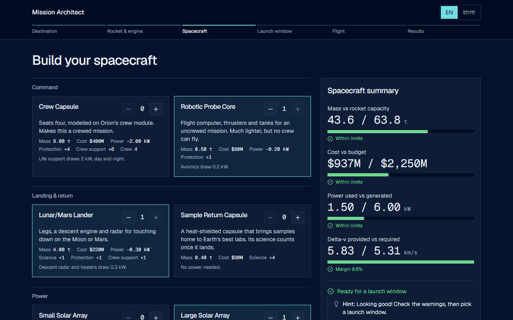

# Mission Architect

A web game that teaches real space mission design, built for the NASA Space Apps Challenge 2026 ("Space Mission Design Game"). It is in English, written in plain language for players who are still learning English: short sentences, common words, and space terms explained the first time they appear.

Pick a destination (the Moon, Mars or the near-Earth asteroid Bennu), a launch vehicle and an engine. Assemble a spacecraft from 20 modules with real trade-offs in mass, cost, power and science, and keep four live budget bars in the safe zone: mass vs rocket capacity, cost vs budget, power used vs generated, and delta-v from the rocket equation vs what the trip needs. Choose a launch window, fly an animated mission that stops for event cards (solar flares, dust storms, equipment failures…) whose outcomes depend on how you built the ship, then get a score, a grade and a debrief that names the decisions that helped and the ones that hurt.



## Run it

```bash
npm install
npm run dev        # http://localhost:5173
npm test           # engine and data tests (vitest)
npm run build      # type-check + static site in dist/
npm run preview    # serve dist/ locally
```

Node 20.19+ (or 22.12+) is needed for Vite 8.

## How to play

1. **Home:** pick a level (Cadet is easy, Engineer is normal, Commander is hard), then Start mission.
2. **Destination:** each card shows distance, travel time, gravity, delta-v needed and radiation.
3. **Rocket and engine:** what the rocket can lift to orbit is your mass limit; the engine's Isp sets how much delta-v each tonne of fuel buys. The fuel slider shows your delta-v live.
4. **Spacecraft:** add and remove parts. The summary shows the four bars, the rocket equation with your own numbers, blocking problems (they disable Continue) and warnings. Cadet gets hints automatically, Engineer on request.
5. **Launch window:** early is faster but needs more delta-v; late is slower and saves fuel.
6. **Flight:** about 70 seconds at 1×. Event cards pause the flight and ask for a decision; "What helps here" shows whether your build is ready for it.
7. **Results:** grade, score breakdown, what helped and what hurt, and the mission log. Fly again, change the spacecraft, or copy a text summary.

**Controls:** everything works with a keyboard: Tab to move, Enter or Space to choose; arrow keys and Page Up/Down move the fuel slider. The flight has 1×/2× speed and "Skip to next event". Reduced-motion settings are respected.

**Handy URLs:** `?seed=12345` pins the event dice so a flight can be replayed exactly; `#destination`, `#vehicle`, `#builder` and `#launchWindow` open those screens directly.

## NASA data

All numbers are baked into JSON in `src/game/data/` (no runtime API calls, no keys in the browser). Every file lists its sources; the in-game **About the numbers** screen shows them with links and every simplification made.

- NASA NSSDC Planetary Fact Sheets: [Moon](https://nssdc.gsfc.nasa.gov/planetary/factsheet/moonfact.html), [Mars](https://nssdc.gsfc.nasa.gov/planetary/factsheet/marsfact.html) (distance, gravity, sunlight)
- [NASA/JPL Small-Body Database: 101955 Bennu](https://ssd.jpl.nasa.gov/tools/sbdb_lookup.html#/?sstr=101955) (size, GM, orbit)
- [NASA DONKI space weather (via CCMC)](https://ccmc.gsfc.nasa.gov/tools/DONKI/) (inspiration for the solar flare card)
- [NASA Open Science Data Repository (OSDR, incl. RadLab)](https://osdr.nasa.gov/bio/) (radiation reasoning)
- Mission references: Apollo 11, Mars 2020 Perseverance, OSIRIS-REx, Opportunity, Dawn, Curiosity, Orion, SLS (links in the data files)

Delta-v needs, radiation levels, costs and event effects are simplified educational values, and the game says so on the About the numbers screen. This project is not affiliated with or endorsed by NASA.

## Deploy (static site)

`npm run build` writes a self-contained static site to `dist/`.

- **Vercel:** import the repo; framework preset "Vite", build command `npm run build`, output directory `dist`.
- **Netlify:** build command `npm run build`, publish directory `dist` (or drag the `dist/` folder onto app.netlify.com/drop).
- **GitHub Pages:** the site is served from `/<repo-name>/`, so build with that base, then publish `dist/` (for example with the `actions/deploy-pages` workflow):

  ```bash
  npm run build -- --base=/mission-architect/
  ```

## Project layout

```
src/game/data/     JSON game data + sources, typed access (index.ts)
src/game/engine/   pure functions: rocket equation, launch checks, mission sim, scoring (+ tests)
src/game/store/    zustand state machine (screens, build, flight, saved settings)
src/game/i18n.ts   every UI string, in plain English
src/screens/       the seven screens and the two info overlays
src/components/    BudgetBar, ChoiceCard, EventCard and other shared parts
```

Working rules, tools and the design system are described in [CLAUDE.md](CLAUDE.md).
